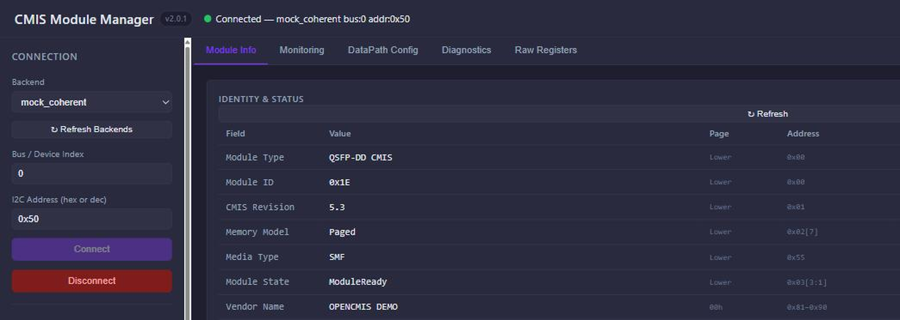

# CMIS Module Manager

A browser-based management tool for CMIS-compliant optical modules (QSFP-DD 800G / 400G and other form factors), built with Flask and vanilla JavaScript. Strictly follows the OIF CMIS 5.3 specification.

基于 Flask + 原生 JS 的光模块可视化管理 Web 工具，严格遵循 OIF CMIS 5.3 规范，支持 QSFP-DD 800G / 400G 等 CMIS 兼容模块。



## 📥 下载 / Download

**免安装 Windows 版：[最新 Release](https://github.com/zhh198903-ctrl/cmis-module-manager/releases/latest)**

下载 `CMIS_dist_v<版本>.zip`，解压后双击 `CMIS_Module_Manager.exe` 即可使用 —— 单文件自包含，
目标机**无需安装 Python**。首次运行 Windows SmartScreen 可能拦截，点「更多信息 → 仍要运行」。

| 解压后的文件 | 说明 |
|---|---|
| `CMIS_Module_Manager.exe` | 单文件 Windows EXE，双击即用 |
| `CMIS模块管理工具操作手册.html` | 完整中文操作手册（浏览器打开） |
| `screenshot_main.png` / `qrcode.jpg` | 辅助资源 |

> ⚠️ **v2.0.0 及更早版本存在 Page 10h 控制寄存器地址错位**，在真实模块上会导致 TX Disable 实际
> 翻转极性、写 RX 极性掩码误触发 ApplyDPInit。**请务必升级到 v2.0.1 或更新版本。**

## Features / 功能

- **Register access 寄存器读写** — raw read/write on any Page/Address, with CMIS field decoding
- **EEPROM read / write 批量 EEPROM 读取与烧写** — 24C02 (256 B) / 24C04 (512 B) / 24C08 (1024 B), chunked reads, hex dump, `.bin` export, 12-character ASCII serial-number patching at `0x000`–`0x00B` (optional position-controlled digit auto-increment per Write, letters never change), Read or `.bin` as the Write source with automatic S/N reload, optional write confirmation (勾选「确认」才弹框，默认不勾选即直接写入), and page-aligned programming with read-back verify
- **Module info 模块信息** — vendor identity, capabilities, power class, applications advertising
- **Real-time monitoring 实时监控** — temperature, VCC, per-lane Tx/Rx power and bias with alarm thresholds
- **DataPath control 数据通道配置** — AppSel provisioning, DataPath state machine, output/squelch controls
- **Diagnostics 诊断** — loopback, PRBS generator/checker, BER, SNR, error counters
- **Laser tuning 激光器调谐** — grid/channel selection and fine tuning for tunable (coherent) modules
- **4 built-in mock modules 内置模拟模块** — `mock_coherent` / `mock_dr8` / `mock_sr8` / `mock_fr4x2`, full demo without any hardware

## Supported hardware / 支持的硬件

| Backend | Adapter |
|---|---|
| `ch341` | WCH CH341 USB-I2C |
| `ch347` | WCH CH347 USB-I2C |
| `cp2112` | Silicon Labs CP2112 USB-HID→I²C/SMBus (SLABHIDtoSMBus.dll) |
| `ftdi`  | FTDI FT232H / FT2232H (via pyftdi) |
| `mock_*` | No hardware needed — simulated modules |

### CP2112 backend / CP2112 后端

The CP2112 is an HID USB-to-I²C/SMBus bridge, driven through Silicon Labs'
`SLABHIDtoSMBus.dll` (with its dependency `SLABHIDDevice.dll`). Notes:

- **DLL placement** — put **both** `SLABHIDtoSMBus.dll` and `SLABHIDDevice.dll`
  next to `app.py` (or next to the EXE after packaging). Override the search
  path with the `CP2112DLL_PATH` env var if needed.
- **32-bit only** — both DLLs are 32-bit PE; the backend self-checks and reports
  *unavailable* under a 64-bit Python. Use the bundled `python32_env` (the
  `start.bat` entry point already does).
- **Address format** — the `Bus` field maps to the CP2112 device number
  (0-based among matching VID/PID `10C4:EA90`). The UI shows the **8-bit bus
  address** (e.g. `0xA0`); the tool shifts it right once to the 7-bit slave
  address (`0x50`) for the API and driver, which then restores the 8-bit form
  for the SMBus call. A legacy 7-bit entry (`0x50`) is still accepted. Up to
  four EEPROM blocks (8-bit `0xA0`–`0xA6`, i.e. 7-bit `0x50`–`0x53`) are
  supported via `set_address()`.
- **Bit rate** — defaults to 100 kHz; set the `CP2112_BITRATE` env var (Hz)
  to change it (e.g. `400000` for a 400 kHz EEPROM bus).
- The EEPROM read uses `HidSmbus_AddressReadRequest` (firmware handles the
  write-address-then-read combined transaction) and writes use
  `HidSmbus_WriteRequest`; transfers are chunked and each write waits for the
  firmware to finish before the next one.
- **Read response buffer (AN496 §2.14)** — `HidSmbus_GetReadResponse` requires
  `bufferSize >= 61` and returns **at most 61 bytes per call**. The driver uses
  a fixed 61-byte buffer and loops until the whole chunk is collected; passing
  the 8/16-byte EEPROM page size as `bufferSize` makes the DLL answer
  `0x04 INVALID_PARAMETER` and every Read fails. Error codes follow the
  AN496 Rev 0.3 table (`0x03` INVALID_DEVICE_OBJECT, `0x04` INVALID_PARAMETER,
  `0x05` INVALID_REQUEST_LENGTH).
- **Exact ctypes signatures matter** — `HidSmbus_GetTransferStatusResponse` has
  **five** out-parameters (`status`, `detailedStatus`, `WORD* numRetries`,
  `WORD* bytesRead`); under-declaring them makes the DLL write into stack
  garbage → `access violation writing 0x...` on Connect. `WriteRequest`'s count
  is a `BYTE` (1–61 bytes, not WORD/250). `BOOL` params in `SetSmbusConfig` are
  4-byte `c_int`. All signatures are verified against the shipped DLL.

CP2112 是 HID 转 I²C/SMBus 桥，通过 Silicon Labs 的 `SLABHIDtoSMBus.dll`
（依赖 `SLABHIDDevice.dll`）驱动。要求：两个 DLL 一起放到 `app.py` 同级目录；
DLL 是 32 位，只能用项目自带的 32 位 `python32_env`；`Bus` 是 CP2112 设备序号，
`Address` 是 7 位从机地址，驱动内部做 8 位移位；速率默认 100 kHz，可用
`CP2112_BITRATE` 环境变量覆盖。

## Quick start / 快速开始

```bash
pip install -r requirements.txt
python app.py
```

Then open **http://127.0.0.1:5000** in your browser. The Backend dropdown opens on
**`ch341`** (the bench default); pick a `mock_*` backend instead and click *Connect* to explore without hardware.

浏览器打开 `http://127.0.0.1:5000`，Backend 默认选中 **`ch341`**；无硬件体验时改为任一 `mock_*` 后端再点击 Connect。

## Tests / 测试

```bash
python test_api.py
```

317 end-to-end API tests run against the Flask test client with the mock backend — no hardware required (CP2112 backend is tested with a fake DLL and real-DLL ABI checks).

## Building a standalone EXE / 构建独立 EXE

```bash
packaging/build_exe.bat   # PyInstaller onefile build
```

The result is `CMIS2Customer/CMIS_Module_Manager.exe`, a single self-contained
file that bundles the Python runtime, Flask, the templates and the static assets.
It runs on a machine with no Python installed — double-click it and the UI opens
at `http://127.0.0.1:5000`.

Prebuilt Windows binaries are attached to each
[Release](https://github.com/zhh198903-ctrl/cmis-module-manager/releases).

## Project layout / 目录结构

```
app.py                  Flask REST API + static hosting entry point
cmis_registers.py       CMIS 5.3 register map / field decoding
i2c_interface.py        Backend factory (list_backends / create_backend)
i2c_backends/           I2C adapter backends (ch341 / ch347 / cp2112 / ftdi / mock)
templates/index.html    Single-page UI
static/                 app.js / style.css
test_api.py             End-to-end API tests
packaging/              PyInstaller spec + EXE build script
CMIS2Customer/          Distribution package content (manual + assets)
```

## EEPROM read / write / 批量 EEPROM 读取与烧写

The **EEPROM Read / Write** tab supports two devices, selectable from the
**EEPROM Chip** dropdown. Choosing a chip sets length, chunk size and addressing
automatically and shows its datasheet parameters (type, bit capacity, vendor,
capacity, page size, I2C addresses):

| Chip | Capacity | Bits | Page | I2C addresses (8-bit) | Layout |
|---|---|---|---|---|---|
| `24C02 [3.3V]` | 256 B | 2 Kbit | 8 B | `0xA0` | 1 × 256 B |
| `24C04 [3.3V]` | 512 B | 4 Kbit | 16 B | `0xA0`–`0xA2` | 2 × 256 B |
| `24C08 [3.3V]` | 1024 B | 8 Kbit | 16 B | `0xA0`–`0xA6` | 4 × 256 B |

The UI lists the **8-bit bus address** (7-bit slave shifted left by one). The
`base_address` you send to the API stays **7-bit** (`0x50`); the UI converts
`0xA0` → `0x50` for you. A 24C04 spreads its 512 bytes over two 256-byte blocks
(8-bit 0xA0/0xA2, i.e. 7-bit 0x50/0x51) and a 24C08 over four (0xA0–0xA6); the
tool retargets the port per block and reads in page-sized chunks:

```json
POST /api/eeprom/read
{"chip": "24C08", "start": 0, "length": 1024,
 "chunk": 16, "base_address": "0x50"}
```

| Field | Meaning |
|---|---|
| `chip` | `24C02` / `24C04` / `24C08` (case-insensitive); picks capacity, page size and addressing from `EEPROM_PROFILES` in `app.py` |
| `length` | Defaults to the chip's capacity and is capped by it |
| `chunk` | Bytes per I2C transfer (1–128), defaults to the chip's write-page size (8 / 16 B) |
| `address_mode` | Legacy `auto` / `single` override, used only when `chip` is absent |

Every chunk issues a fresh START + word address, which avoids both the
CH341/CH347 stream-buffer limit and the 24Cxx wrap-around at 256-byte
boundaries. A dump covering `0x000`–`0x00B` additionally returns
`serial_number` (the 12-character ASCII text), `serial_bytes` (its ASCII codes),
`serial_hex` (the raw bytes) and `serial_next` for those 12 bytes.
The CMIS page-select byte `0x7F` is **never written** — on a plain EEPROM that
byte is data. `Save .bin` exports the last dump (filename includes the chip
model); `Copy Hex` copies the byte string.

The **刷新** button beside the file picker re-reads the already-selected `.bin`
and re-renders the content area — useful after the file changed on disk, or
after `Clear` emptied the view. It stays disabled until a file has been chosen
and shares the file picker's load path, so the S/N field is reloaded and Write
is re-armed exactly as on the initial selection. To pick a different file, use
the picker itself.

### Blank-chip auto-program / 空白芯片自动烧写

This is **opt-in** via the **烧写空白** checkbox next to the other switches; it
is **off by default**, so an ordinary Read is always read-only. Only when it is
ticked does clicking **读取** consider programming an erased chip. When a Read
then finds an **erased part** — all 12 bytes at `0x000`–`0x00B` are `0xFF`,
reported as `blank_chip: true` — **and** a `.bin` has already been selected (its
first 12 bytes supplied the Serial Number field), that `.bin` is automatically
programmed into the chip:

- The S/N is advanced **first** (`CAD211193882` → `CAD211193883`) and the
  incremented value is what gets written and shown in the field, becoming the
  base for the next board.
- The write is **silent**: no confirmation dialog, no second increment. It
  reuses `/api/eeprom/write` with `patch_serial: true`, so every server-side
  guard (ASCII check, increment range, page/boundary splitting, verify) still
  applies.
- It is mutually exclusive with **Auto update**: an erased part has no product
  S/N, so the consumption repair cannot run on it.
- Nothing is consumed unless the file, its length, the S/N and the increment
  range all validate — a bad image must not burn a serial number.
- If the checkbox is unticked, a blank chip is merely reported and **nothing is
  written** — the Read stays read-only. The same applies if no `.bin` is
  selected: the erased dump is shown and Write is enabled, as before.

**Periodic read / 定时读取:** clicking **读取** while **烧写空白** is ticked also
arms an automatic re-read every **2 seconds**, for unattended blank-chip
programming (swap in a fresh part, it gets detected and programmed on the next
tick). The timer never self-starts; only an explicit Read click with the box
ticked arms it. **Unticking 烧写空白 stops it immediately**, as does
disconnecting. Re-arming is idempotent (no stacked timers), and a tick that
lands while a prior read/program is still in flight is skipped, so reads never
overlap.

### Erase the whole chip / 清空芯片

The red **清空芯片** button (next to **清除**) is a **physical, irreversible**
erase: it writes `0xFF` to every byte of the selected chip by sending a full
capacity-sized image to `/api/eeprom/write` with `patch_serial: false`, so the
editable Serial Number is never stamped into `0x000`–`0x00B`. It **always** shows
the confirmation dialog, regardless of the 确认 checkbox — a wipe can never be
silent — and it does not change or consume the S/N. On success the content area
shows the exact all-`0xFF` image that went onto the part (which subsequent
Reads report as `blank_chip: true`). Do **not** use it on a live CMIS optical
module.

Do not confuse it with **清除** (Clear), which only empties the on-screen
content area and disarms Write — it never touches the chip.

### Writing the content area / 烧写内容区

The **content area** (hex dump) is the single source for Write. It is filled by
either a successful **Read** or by choosing a `.bin`; whichever happened last
wins. A successful Read therefore **enables the Write button even when no file
was selected**, and copies the 12 ASCII bytes at `0x000`–`0x00B` into the **Serial
Number** field — the standard "read a golden part → program the next boards"
flow. A failed Read restores the previous image; `Clear` and disconnecting
discard a chip readback, while a `.bin` loaded from disk survives a reconnect.
A partial dump starting above `0x000` is written verbatim (`patch_serial:
false`) because it contains no serial bytes.

### Optional confirmation / 可选写入确认

A browser's native `window.confirm()` is drawn at the **top of the viewport**
and its position cannot be changed by page JavaScript. When confirmation is
requested, the tool uses an in-page `<dialog>` instead, anchored **just above
the `Write .bin → EEPROM` button** with `确定` / `取消` in its **last row** —
the OK button ends up a few pixels above the button just clicked, and `Enter`
works immediately because OK receives focus. `Esc`, `取消` and a backdrop click
abort without writing. If the viewport has no room above, the dialog drops
below the button and moves the action row back to the first row.

The **确认 / Confirm** checkbox beside `Verify` is an **opt-in confirmation
switch**, unticked by default and kept across reconnects:

| Checkbox | Write click behaviour |
|---|---|
| Unticked (default) | Programs **immediately** — no dialog, no toast, no extra click |
| Ticked | Shows the in-page dialog; only `确定` / `Enter` proceeds |

Unticking it while the dialog is open cancels that dialog. The backend still
requires JSON `confirm: true` on every `/api/eeprom/write` call; that protocol
flag is independent of this UI preference.

### Auto update / 自动更新消耗量

The **自动更新 / Auto update** checkbox (default **off**) automates one repair:

1. On **Read**, the backend analyses the dump. It reports `serial_rule_ok` when
   the first 12 bytes match the consumable-chip product S/N layout — 3 letters
   + 5-digit `YYDDD` date + 4 hex-digit serial (e.g. `CAA212600066`,
   `CAD211194102`) — and reports the remaining-capacity percentage from the
   BE16 field at `0x09C`–`0x09D` (`0x0064` = 100%).
2. If the checkbox is ticked **and** `serial_rule_ok` **and** consumption is not
   already 100%, the tool patches those two bytes to `0x0064` and writes the
   image back **silently** — no confirmation dialog, and **no Serial Number
   increment** (the chip being repaired is the same chip just read).
3. Anything else — unticked checkbox, malformed S/N, already-100%, or a dump
   that does not reach `0x09C` — leaves the image untouched. Read itself never
   writes; the analysis fields are informational only.

The S/N rule checks the *shape*, not a fixed `CAA`/`CAD` whitelist, because the
reverse-engineering report notes more product families may appear. It mirrors
`D:\Workbuddy\24C08\24C08_芯片数据分析报告.md`.

The **Serial Number** field (which replaced the old status box) holds **12
printable ASCII characters**, e.g. `CAD211193882`, stored as their ASCII codes
in EEPROM bytes `0x000`–`0x00B`. Non-ASCII bytes read from a chip are reported
as a raw hex view and never overwrite the editable field. The value is
persisted in this browser (`cmis.eeprom.sn.ascii`). The **自动递增 /
Auto-increment** checkbox next to `Next` controls whether a Write advances it:

| 自动递增 | Write 后的 S/N |
|---|---|
| Ticked (default) | **Selected digit run +1**, keeping its width, on every Write actually sent, success or failure — a partly programmed part never shares its serial with the next one |
| Unticked | **Unchanged** after a Write; program a batch with one S/N and advance only by clicking `Next` |

**Letters never change.** The *递增位置 / Increment at* field decides which
characters may advance. Leave it empty (or enter `auto`) to detect the last
digit run; enter a 0-based inclusive range such as `3-9` to pin it explicitly.
This is what allows letter suffixes:

| Current S/N | 递增位置 | Next |
|---|---|---|
| `CAD211193882` | empty → auto (`3-11`) | `CAD211193883` |
| `CAA2127891EB` | empty → auto (`3-9`) | `CAA2127892EB` |
| `CAA2127891EB` | `9-9` | `CAA2127892EB` |
| `CAD21119388D` | empty → auto (`3-10`) | `CAD21119389D` |

Overflow wraps inside the selected run (`CAD999999999` → `CAD000000000`).
An invalid range (out of bounds or covering a letter) is rejected with 400
**before** any write happens.

A cancelled dialog consumes no Serial Number either way. Reading the chip or
selecting a `.bin` reloads the 12 bytes from the content area automatically
(the old `Init` button is gone).

`Write .bin → EEPROM` patches bytes `0x000`–`0x00B` with those 12 characters and
programs the image from the offset it was read at (normally `0x000`):

```json
POST /api/eeprom/write
{"confirm": true, "chip": "24C08", "start": 0,
 "serial_number": "CAD211193882", "data_b64": "...base64 image...",
 "verify": true, "write_delay_ms": 10}
```

| Field | Meaning |
|---|---|
| `confirm` | Must be JSON `true` — a write is irreversible on the part |
| `chip` | Required. Sets capacity and the page size used for splitting |
| `data_b64` | Base64 image; `data` as a list of byte values is also accepted |
| `start` | Linear offset of the image (default 0). The UI sends the offset the dump was read from, so a partial dump is written back to the same place |
| `patch_serial` | `false` writes the image verbatim — used automatically when the image does not cover `0x000`–`0x00B` |
| `serial_number` | Exactly 12 printable ASCII characters (`CAD211193882`) or a list of 12 ASCII codes, written to `0x000`–`0x00B`; `patch_serial: false` writes the image verbatim |
| `serial_pos` | 0-based inclusive character range to increment (`3-9`, `3:9` or `9`); empty/`auto` detects the last contiguous digit run, even when followed by letters. Letters outside the range are never changed; used for `serial_next` in both read and write responses |
| `chunk` | Max bytes per I2C write (1–128); still clipped to one page |
| `write_delay_ms` | tWR wait after every page (0–100, default 10) |
| `verify` | Re-read each page and report mismatches (default true) |

Every transfer is clipped at **both** the write-page boundary (8 / 16 B) and the
256-byte block boundary, then followed by a write-cycle wait. 24C04 writes
retarget 8-bit `0xA0`–`0xA2` (7-bit `0x50`–`0x51`), 24C08 writes `0xA0`–`0xA6`
(7-bit `0x50`–`0x53`), and the originally connected address is restored
afterwards.
The response carries `serial_bytes`, `serial_hex`, `serial_next`, `transactions`,
`segments`, `verified`, `mismatch_count` and a short SHA-256 digest of the
programmed image.

> ⚠️ **Writing overwrites the EEPROM and cannot be undone.** Never point it at a
> live CMIS optical module. On a real CMIS module select `24C02` and read only
> the first 256 bytes: the extra blocks at 8-bit `0xA2`/`0xA4`/`0xA6` do not exist there. The Mock demo
> backend rewrites dynamic registers (0x03, 0x0E–0x0F) on every read, so
> `Verify` can report false mismatches there; real 24Cxx hardware is unaffected.

## Notes / 说明

- The OIF CMIS 5.3 specification itself is **not** included in this repository. Download it from the [OIF website](https://www.oiforum.com/technical-work/implementation-agreements-ias/).
- Vendor names appearing in the mock profiles are simulated demo data and do not imply any affiliation.

## License

[MIT](LICENSE)
